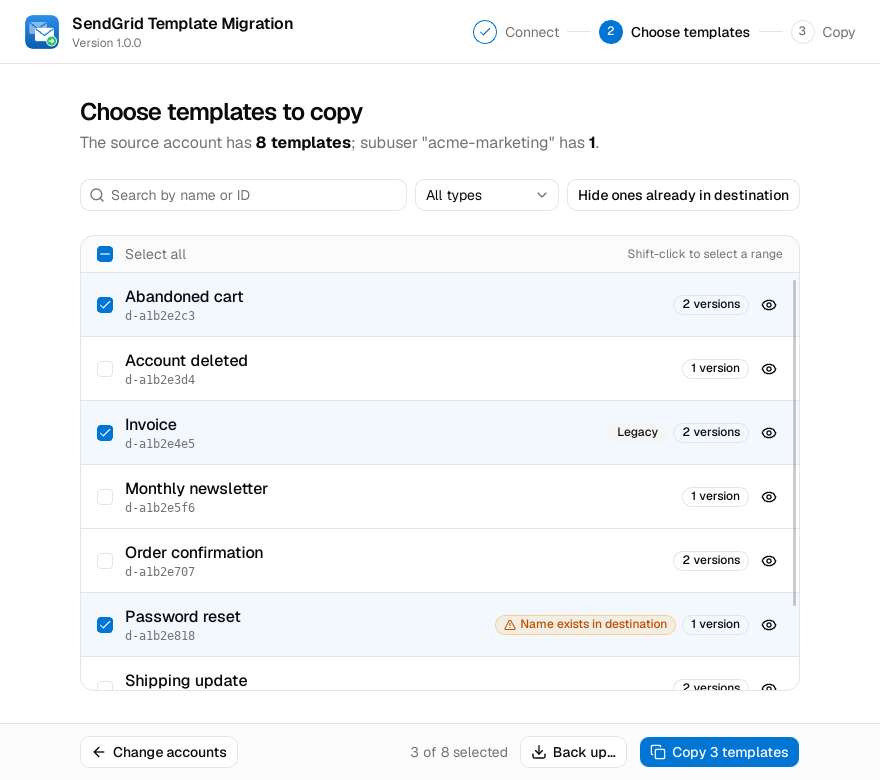
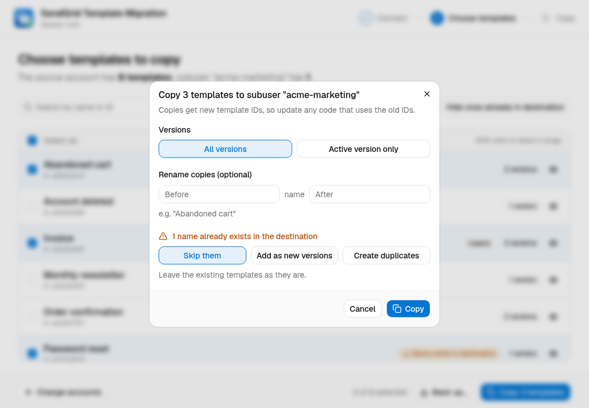
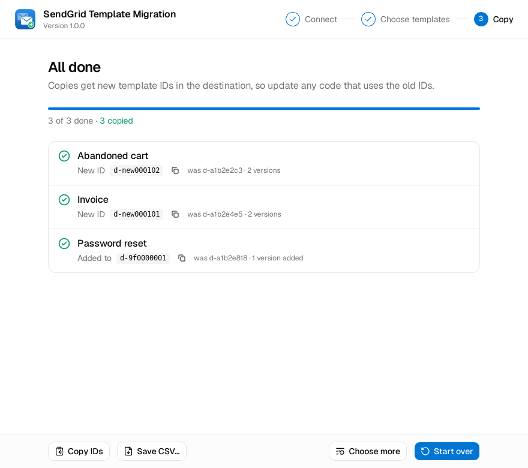

# SendGrid Template Migration

Copy SendGrid templates, including every version, from one account to another: for example, from a parent account to a subuser, between subusers, or via a backup file.



## Download & install

Get the latest build from the [Releases](../../releases) page:

| OS | File | Install |
| --- | --- | --- |
| Windows 10/11 | `..._windows_amd64_setup.exe` | Run it. Adds the app to the Start menu and desktop. No admin rights needed. Uninstall from **Settings → Apps**. |
| Windows (no install) | `..._windows_amd64_portable.zip` | Unzip and double-click `sendgrid-template-migration.exe`. |
| macOS (Apple Silicon) | `..._macos_arm64.dmg` | Open it and drag the app into **Applications**. |
| Fedora | `....x86_64.rpm` | `sudo dnf install ./sendgrid-template-migration-*.x86_64.rpm` |
| Debian / Ubuntu | `..._amd64.deb` | `sudo apt install ./sendgrid-template-migration_*_amd64.deb` |

On Linux, the app then appears in your app launcher as **SendGrid Template Migration**. It needs glibc 2.34 or newer and WebKit2GTK 4.1; the package pulls in WebKit2GTK automatically. Tested on Fedora 44 and Ubuntu 24.04. It should also work on Ubuntu 22.04, the system it is built on.

On Windows it uses the Microsoft Edge WebView2 runtime, which comes with Windows 11 and up-to-date Windows 10.

The builds aren't code-signed, so the OS warns the first time you open them:

- **Windows:** SmartScreen says "Windows protected your PC". Click **More info** → **Run anyway**.
- **macOS:** It says the app "can't be opened" or "is damaged". Run `xattr -dr com.apple.quarantine "/Applications/SendGrid Template Migration.app"` once in Terminal. Or open **System Settings → Privacy & Security** and click **Open Anyway**.

## Usage

Open the app from your app launcher, Start menu or Applications folder. It walks you through three steps:

1. **Connect:** pick the data region (EU accounts need the EU region), then where to copy from and to.

   | Copy from | Copy to |
   | --- | --- |
   | **Account API key:** any account's key, usually the parent's. Needs read access to Template Engine. | **Account API key:** the destination account's own key, with full access to Template Engine. |
   | **A subuser:** the parent key acting as one of its subusers (SendGrid's `on-behalf-of`). | **A subuser:** the parent key acting as the subuser, so you don't need the subuser's own key. The parent key needs full access to Template Engine. |
   | **Backup file:** a file saved earlier by this app. | **Parent account:** when copying from a subuser, back to the parent the key belongs to. |
   | | **Backup file:** save the templates to a file instead of copying them. |

   **Find** lists the parent's active subusers to pick from (needs read access to Subuser Management). Both sides are checked before you continue. Keys are never saved.
2. **Choose templates:** search, filter by type, hide templates that are already in the destination, and click the eye icon to preview a template. Shift-click selects a range. Templates whose name already exists in the destination are flagged. **Back up…** saves the selected templates to a file.

   **Copy** then asks how to copy them:
   - **Versions:** all versions, or only the active one.
   - **Rename copies:** add text before and/or after each name.
   - **If the name already exists:** skip the template, add its versions to the existing template (which keeps that template's ID), or create a duplicate alongside it.

   
3. **Copy:** a few templates are copied at a time, with live progress, and you can cancel. Each template shows its new ID with a copy button. **Copy IDs** puts `name, old ID, new name, new ID` on the clipboard, and **Save CSV…** saves every result to a file. If some templates fail, **Retry** copies them again with the same options.

   

New templates get new IDs in the destination, so update any code that references the old IDs.

If a copy fails partway, the app deletes the incomplete template (or the versions it added), so a failed copy leaves nothing behind. Temporary SendGrid errors and rate limits are retried automatically.

The app checks GitHub for a newer release when it starts, and shows a link in the header if there is one.

### Command line

Pass `-template` to copy without opening the window, e.g. from a script:

```sh
export SENDGRID_SRC_API_KEY=SG.parent...   # needs Template Engine read access

# Using the subuser's own key:
SENDGRID_DST_API_KEY=SG.subuser... sendgrid-template-migration -template d-1234567890abcdef
# Or using the parent key on behalf of a subuser:
sendgrid-template-migration -dst-subuser acme-marketing -template d-1234567890abcdef

# See what would happen first, skipping templates whose name already exists:
sendgrid-template-migration -dst-subuser acme-marketing -template d-1234,d-5678 -on-existing skip -dry-run

# List the source templates:
sendgrid-template-migration -list
# Back up every template to a file, then copy them all from it later:
sendgrid-template-migration -export templates.json
SENDGRID_DST_API_KEY=SG.other... sendgrid-template-migration -import templates.json
```

| Flag | Description |
| --- | --- |
| `-template` | Template ID to copy. Repeat the flag or pass a comma-separated list. |
| `-src-key` | Source (parent) API key. Env: `SENDGRID_SRC_API_KEY`. |
| `-src-subuser` | Copy from this subuser, using `-src-key` as its parent. Env: `SENDGRID_SRC_SUBUSER`. |
| `-import` | Copy from a backup file instead of an account. Copies every template in it unless `-template` is given. |
| `-dst-key` | Destination account's API key. Env: `SENDGRID_DST_API_KEY`. |
| `-dst-subuser` | Copy to this subuser using the source key instead of `-dst-key`. Env: `SENDGRID_DST_SUBUSER`. With `-src-subuser` and neither `-dst-key` nor `-dst-subuser`, templates are copied to the parent account. |
| `-name` | Name for the copy. Works only with a single template. |
| `-prefix`, `-suffix` | Text to add before or after each copy's name. |
| `-active-only` | Copy only the active version. |
| `-on-existing` | When the destination already has a template with the copy's name: `duplicate` (default), `skip`, or `add` its versions to the existing template. |
| `-dry-run` | Show what would be copied without changing the destination. |
| `-list` | List the source templates and exit. |
| `-export` | Save the `-template` templates (default: all), with every version, to a backup file instead of copying. |
| `-json` | Print the template list or copy results as JSON. |
| `-base-url` | Defaults to `https://api.sendgrid.com`. Use `https://api.eu.sendgrid.com` for EU accounts. |
| `-version` | Print the version. |

The command exits with status 1 if any template failed to copy. Without `-template`, `-list`, `-export` or `-import`, the window opens with the keys, subusers and `-base-url` pre-filled from these flags and environment variables.

## Development

The window is a [Wails v3](https://v3.wails.io) app. The UI is React + TypeScript + [Tailwind CSS](https://tailwindcss.com) + [shadcn/ui](https://ui.shadcn.com) in `frontend/`, built with Vite and embedded in the Go binary.

| Path | What |
| --- | --- |
| `main.go` | Flags; opens the window, or runs a command-line task |
| `cli.go` | The command-line tasks: list, export, copy |
| `sendgrid.go` | SendGrid API client, and `CopyTemplate` |
| `copy.go` | Copying several templates at once, shared by the window and the command line |
| `backup.go` | Backup files, which can also be copied from |
| `connection.go` | Source/destination accounts, including the on-behalf-of modes |
| `app.go` | The backend service the UI calls (`Connect`, `CopyTemplates`, …) |
| `update.go` | The new-release check |
| `frontend/src/screens/` | The three screens and the preview dialog |
| `frontend/src/bindings/` | TypeScript bindings generated from `app.go`. Run `make bindings` after changing it. |
| `packaging/` | Build scripts, Linux `.desktop` file and package config, Windows installer script, `release-notes.sh` |
| `CHANGELOG.md` | What changed in each version; each section becomes that version's release notes |
| `AGENTS.md` | Commands, Go and React/TypeScript conventions, and changelog rules, for contributors and AI coding agents |

Install the toolchain: Go, Node.js 20.19+ or 22.12+ (needed by Vite), and the system web view headers.

```sh
# Fedora (its nodejs package is new enough and includes npm)
sudo dnf install gcc make nodejs gtk3-devel webkit2gtk4.1-devel
# Ubuntu / Debian (their nodejs packages are too old: install Node from https://nodejs.org or nvm)
sudo apt install gcc make libgtk-3-dev libwebkit2gtk-4.1-dev
# Bindings generator, only needed for `make bindings`
CGO_ENABLED=0 go install github.com/wailsapp/wails/v3/cmd/wails3@v3.0.0
```

```sh
make dev       # same as F5 in VS Code, without the debugger
make test      # go test -race
make lint      # golangci-lint (install it separately) + oxlint, which must report no warnings
make bindings  # regenerate frontend/src/bindings after changing app.go
make build     # dist/sendgrid-template-migration
```

To use `go` directly, build the frontend first (`make frontend`), because the binary embeds `frontend/dist`. On Linux, also pass `-tags gtk3`; without it, Wails expects GTK4 and WebKitGTK 6.0.

### VS Code

The repo includes a VS Code setup in `.vscode/`. Open the project folder and install the recommended extensions when prompted: Go, Tailwind CSS IntelliSense and Oxc. The first time you debug, the Go extension also offers to install its debugger (Delve); accept it.

Press **F5** (or **Run and Debug → App (live UI)**). VS Code then:

1. Builds the frontend once if `frontend/dist` doesn't exist yet. The Go binary embeds it, so Go can't compile without it.
2. Starts the Vite dev server on port 34115 as a background task.
3. Runs the app under the Go debugger, with its UI served by Vite.

While it runs:

- **Go:** breakpoints in `app.go`, `connection.go` etc. work as usual. Restart (**Ctrl+Shift+F5**) after changing Go code.
- **React:** edits in `frontend/src` appear in the window immediately, with no restart.
- **Inspecting the UI:** right-click in the window → **Inspect Element** opens the web inspector for the page, its console and network requests.
- **Changing what `app.go` exposes to the UI:** run **Terminal → Run Task → bindings: regenerate**, then restart.

The Vite server keeps running between debug sessions; stop it with **Terminal → Terminate Task**. The other debug configurations are **App (built UI)**, which runs with the frontend embedded as in a release, and **Go tests**. Test and lint are also available as tasks.

`.vscode/settings.json` sets the `gtk3` build tag for the Go extension, so it doesn't report errors about missing GTK4 packages.

## Releases (GitHub Actions)

Record changes under `## [Unreleased]` in `CHANGELOG.md` as you make them, grouped as **Added**, **Changed**, **Fixed**, **Removed** or **Security**. To release:

1. Rename `## [Unreleased]` to `## [1.2.0] - YYYY-MM-DD`, add a new empty `## [Unreleased]` above it, and update the compare links at the bottom.
2. Check the notes with `packaging/release-notes.sh 1.2.0`, then commit.
3. Push a version tag to build every platform and publish a GitHub Release:

```sh
git tag v1.2.0
git push origin main v1.2.0
```

That version's `CHANGELOG.md` section becomes the release description. The build fails straight away if the section is missing or empty.

Every push to `main` and every pull request also builds everything. Those files are attached to the workflow run (**Actions** tab → run → **Artifacts**) and no release is published. See `.github/workflows/release.yml`.

| Job | Runner | Produces |
| --- | --- | --- |
| Linux + Windows | `ubuntu-22.04` | `.deb`, `.rpm`, `.tar.gz`; Windows installer and portable `.zip` (Wails on Windows needs no C compiler, so it cross-compiles) |
| macOS | `macos-latest` (Apple Silicon) | `.dmg` containing the `.app` |

The Linux job also checks that `frontend/src/bindings` matches `app.go`, lints the frontend, and runs the Go tests with the race detector.

To build installers locally: `make linux` (needs `nfpm`), `make windows` (needs `nsis`, `zip`, `go-winres`), or `make macos` (on a Mac).
